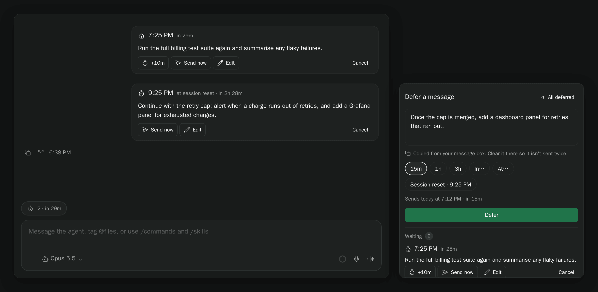
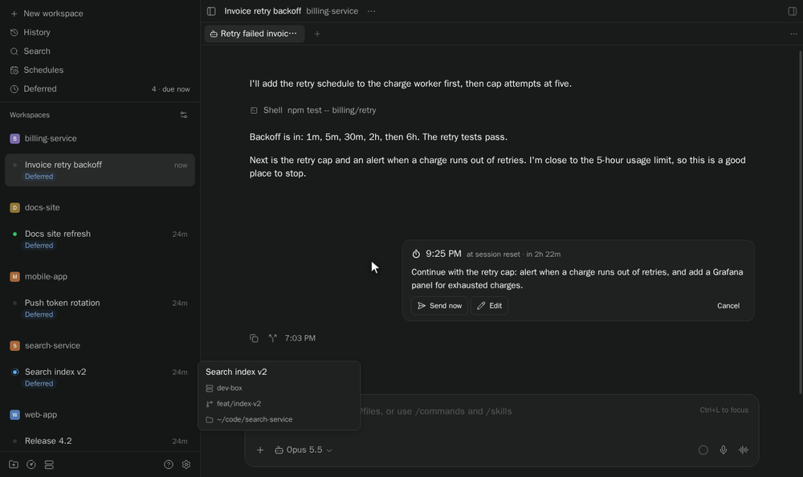
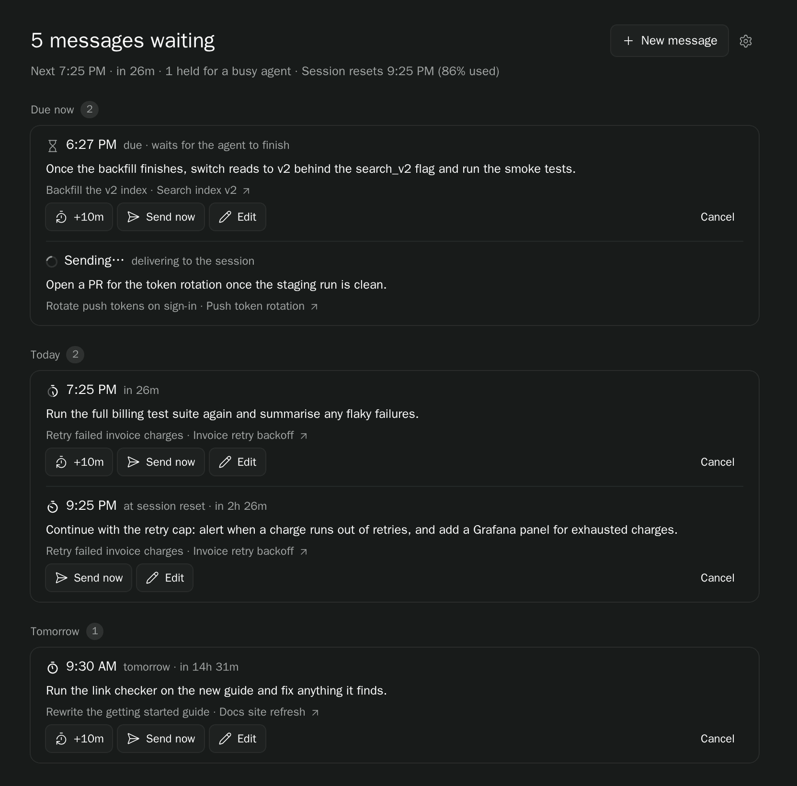
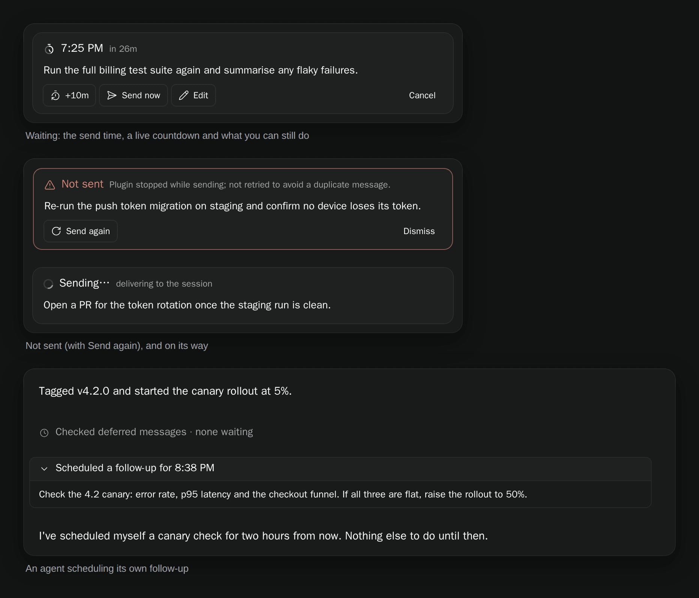
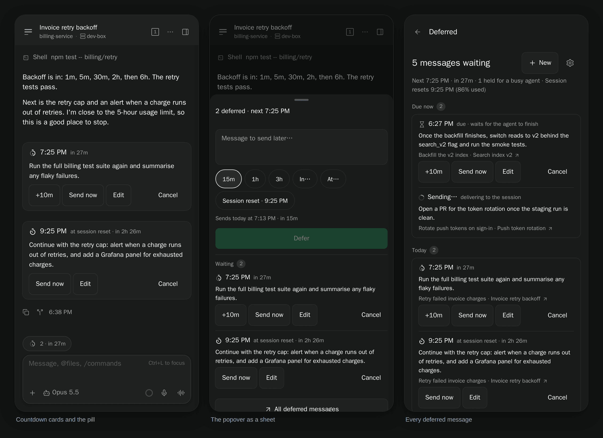

# paseo-defer

[](https://www.npmjs.com/package/paseo-defer)
[](https://www.npmjs.com/package/paseo-defer)
[](https://paseo.sh)
[](LICENSE)

Queue a message for an agent and send it later: after a delay, at a set time, or when your usage window resets. Every queued message shows the time it goes out, in the composer, in the chat and in one Deferred list. It is only sent once the agent is idle, and the queue survives reloads, restarts and a closed app.

<picture>
  <source media="(prefers-color-scheme: light)" srcset="docs/media/defer-hero-light.png">
  
</picture>

Screenshots use synthetic workspaces and messages.

## Install

```sh
paseo plugin install paseo-defer
```

## Use

Write your message, then press **Defer**: on Paseo 0.16 it is the timer button in the session's composer toolbar; on a phone (a window under 600px wide) and on older Paseo it is the pill above the message box. Or choose **Defer a message** from ⌘K / Ctrl+K). Defer takes what you typed. On Paseo 0.16 it empties the prompt box once the message is queued (unless you changed the box in the meantime); on older Paseo it copies the text, so clear the prompt box afterwards. Pick `15m`, `1h` or `3h`, **In…** for any wait up to 30 days, **At…** for a local time, or **Session reset**. The line under the options says exactly when it will send. You can also schedule straight from the composer:

```text
/defer 2h ship the release notes
/defer 9:30 pm review the changes
/defer reset continue the task
```



- **On Paseo 0.16 the composer button shows the queue in its glyph and tooltip.** The timer glyph turns bright and drains toward the next send, and the tooltip reads `Defer · 2 waiting · next 4:42 PM`. On a phone and on older Paseo, **the pill shows the next send.** It counts down inside the hour (`in 47m`), shows the clock after that (`4:42 PM`), and leads with the count when more are waiting (`2 · 4:42 PM`). Its timer drains as the time gets closer.
- **Each queued message sits in its chat** as a card with the send time and a live countdown, plus **+10m**, **Send now**, **Edit** and **Cancel**. The card goes away once the message is sent; the sent message carries a **Deferral details** attachment with the scheduled and actual send times. If a send fails, the card says why and offers **Send again**.
- **Deferred** in the sidebar lists every queued message by when it goes out (Due now, Today, Tomorrow, At session reset), with **Recent activity** underneath. **New message** writes to any session.



- **Agents can schedule their own follow-ups** with `defer_schedule_message` and read their queue with `defer_list_messages`. They can't target other agents. Their calls show as one-line rows in the chat.



On a phone the popover opens as a bottom sheet and the Deferred screen stacks each message's actions under it.



**Settings → Plugins → Defer → Display** sets where Defer shows up: the composer button (or pill) on every session, only while messages wait, or not at all, and whether the sidebar row is shown.

## How it works

- The queue is checked every 15 seconds. A due message waits until the agent finishes its turn, so it never lands mid-turn; until then it reads `due · waits for the agent to finish`.
- **Session reset** follows your provider's rolling usage window (Claude's 5-hour window, Codex's session) and sends when it rolls over. The option shows when the window resets and how much of it is used.
- **Send now** moves the time to now. It still waits for the agent to be idle.
- If the plugin stops while sending, the message is marked **Not sent** rather than retried, so it can never arrive twice. **Send again** is your call.

## Data and access

Paseo plugins run trusted, unsandboxed code on the daemon host. Queued messages and settings live in `$PASEO_HOME/plugin-data/defer/`. For password-protected daemons, the plugin reads `PASEO_PASSWORD`, then `PASEO_PASSWORD_FILE`, then `~/paseo-hub/secrets/daemon-password`, and never logs or stores it.

## Development

```sh
npm ci
npm run verify
paseo plugin install .
paseo plugin reload paseo-defer   # after changes
```

## License

[MIT](LICENSE) © 2026 Tom Gringauz.

## Other plugins

- [Follow-up](https://github.com/tomgrin10/paseo-follow-up) — Track workspace PRs, remaining tasks and completion.
- [Send to Paseo](https://github.com/tomgrin10/send-to-paseo) — Send GitHub and Graphite PRs to Paseo from Chrome.
- [Session Guard](https://github.com/tomgrin10/paseo-session-guard) — Pause at session limits and continue after reset.
- [Smart Session](https://github.com/tomgrin10/paseo-smart-session) — Context compaction and usage insights.
- [Transcript Search](https://github.com/tomgrin10/paseo-transcript-search) — Search conversations across connected hosts.
- [Transfer](https://github.com/tomgrin10/paseo-transfer) — Copy or move workspaces between hosts.
- [Vitals](https://github.com/tomgrin10/paseo-vitals) — Host, process, agent and Docker monitoring.
- [Workspace Switcher](https://github.com/tomgrin10/paseo-switcher) — Arc-style Ctrl+Tab between recent workspaces.
